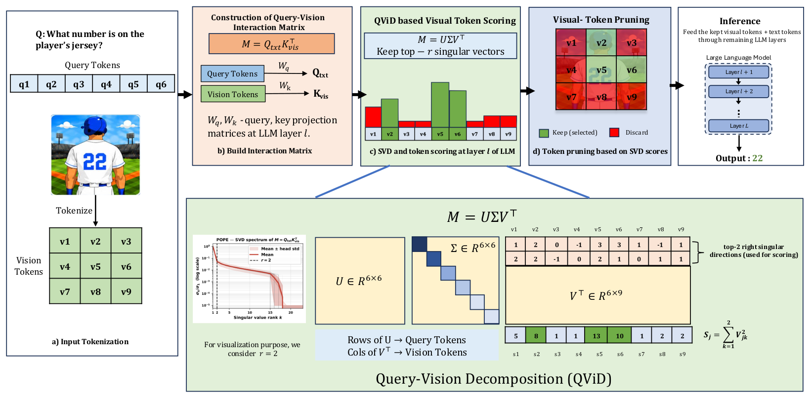

<div align=center>

<h1>Vision Token Pruning via Query–Vision Interaction Decomposition</h1>

<h4 align="center">

Harshithanjani Athi<sup>1</sup>,
Sravan Kumar Ankireddy<sup>1</sup>,
Jianzhong Charlie Zhang<sup>2</sup>,
Hyeji Kim<sup>1</sup>

<sup>1</sup>The University of Texas at Austin, <sup>2</sup>Samsung Research America

</h4>

[](https://arxiv.org/abs/2610.33215)

</div>

<p align="center"></p>

> **TL;DR:** We observe that the query–vision interaction matrix, naturally induced by the query and key projections already present in transformer attention, is effectively low-rank, with a small number of dominant latent interaction modes capturing query-relevant semantics. Motivated by this observation, we propose Query-Vision Decomposition (QViD), a training-free, query-aware visual token pruning method that exploits this structure.

## 💥 Core Codes

The core implementation is in [`llava/model/language_model/QViD.py`](llava/model/language_model/QViD.py).

## 🔍 Method

QViD performs query-aware visual-token pruning by explicitly modeling query–vision interactions. At pruning layer $\ell$, it forms the interaction matrix $M = Q_{\text{txt}} K_{\text{vis}}^\top$, extracts its dominant low-rank modes with SVD, and scores each visual token by its participation in these modes. The top $K$ tokens are retained for subsequent reasoning.

**Query–vision interaction matrix.** Let $H^{(\ell)}_{\text{vis}} \in \mathbb{R}^{N_v \times d}$ and $H^{(\ell)}_{\text{txt}} \in \mathbb{R}^{N_q \times d}$ be the hidden states of the visual and query tokens at layer $\ell$. For a given attention head, using the frozen query and key projections $W_Q, W_K$,

$$Q_{\text{txt}} = H^{(\ell)}_{\text{txt}} W_Q, \qquad K_{\text{vis}} = H^{(\ell)}_{\text{vis}} W_K, \qquad M = Q_{\text{txt}} K_{\text{vis}}^\top \in \mathbb{R}^{N_q \times N_v}.$$

**Visual-token scores.** For each head we compute the singular value decomposition $M = U \Sigma V^\top$ and score visual token $j$ by its participation in the top $r$ right singular directions, averaged over the $H$ attention heads:

$$s_j = \frac{1}{H} \sum_{h=1}^{H} \sum_{k=1}^{r} \left(V^{(h)}_{jk}\right)^2 .$$

For short queries, $r$ is replaced by $r_{\text{eff}} = \min(r, N_q, N_v)$.

**Visual-token pruning.** The top $K$ visual tokens with the largest scores $s_j$ are passed to the remaining LLM layers, with $K$ determined by the token budget. QViD is entirely training-free and uses only the frozen projections already present in the model. We use layer $\ell = 3$ and $r = 16$.

## 🛠 Preparation

1. Clone this repository.

```bash
git clone https://github.com/harshithanjaniathi/QViD.git
cd QViD
```

2. Environment setup.

```bash
conda create -n qvid python=3.11 -y
conda activate qvid

# PyTorch (pick the wheel for your CUDA version)
pip install torch==2.5.1 torchvision==0.20.1 --index-url https://download.pytorch.org/whl/cu121

# lmms-eval v0.7.1, with our evaluation patch
git clone --branch v0.7.1 --depth 1 https://github.com/EvolvingLMMs-Lab/lmms-eval.git
git -C lmms-eval apply ../patches/lmms-eval-v0.7.1.patch
pip install -e lmms-eval

# QViD (this LLaVA fork). Installed last: it pins transformers==4.37.2, which
# LLaVA-1.5 needs. pip warns that lmms-eval asks for a newer one; that is expected.
pip install -e .
```

3. Download [LLaVA-1.5-7B](https://huggingface.co/liuhaotian/llava-v1.5-7b) and put it under `./liuhaotian/llava-v1.5-7b` (the scripts fall back to the Hugging Face id if it is not there). The CLIP vision tower is downloaded automatically.

```bash
huggingface-cli download liuhaotian/llava-v1.5-7b --local-dir ./liuhaotian/llava-v1.5-7b
```

4. Benchmarks are downloaded from the Hugging Face Hub by lmms-eval on first use. Several `lmms-lab` datasets require a Hugging Face login:

```bash
huggingface-cli login
```

## 🚀 Evaluation

[`scripts/v1_5/eval.sh`](scripts/v1_5/eval.sh) runs [lmms-eval](https://github.com/EvolvingLMMs-Lab/lmms-eval). The first argument is the number of visual tokens kept (default 64; 576 = vanilla LLaVA-1.5), the optional second a comma-separated list of lmms-eval tasks (default: all 11 benchmarks).

```bash
# All 11 benchmarks with 64 visual tokens
CUDA_VISIBLE_DEVICES=0 bash scripts/v1_5/eval.sh 64

# Selected benchmarks
CUDA_VISIBLE_DEVICES=0 bash scripts/v1_5/eval.sh 64 textvqa_val,mme
```

The 11 benchmarks: `gqa`, `scienceqa_img`, `textvqa_val`, `pope`, `mme`, `mmbench_en_dev`, `mmstar`, `ai2d`, `chartqa`, `ocrbench`, `hallusion_bench_image`. Results are written to `./results/llava-v1.5-7b-qvid<NUM_TOKENS>/`.

## 💻 Usage in your own code

```python
from llava.model.builder import load_pretrained_model

tokenizer, model, image_processor, _ = load_pretrained_model(
    "liuhaotian/llava-v1.5-7b", None, "llava-v1.5-7b")
model.get_model().set_qvid(num_tokens=64, layer=3, num_components=16)

# Use model.generate(...) exactly as in LLaVA; pruning happens inside.
```

| Argument | Default | Description |
|---|---|---|
| `num_tokens` | 64 | Visual tokens kept from `layer` onward (`None` or 576 = no pruning). |
| `layer` | 3 | LLM layer at whose input tokens are scored and pruned. |
| `num_components` | 16 | Rank `r` of the singular subspace. |

A single-image demo:

```bash
python scripts/demo.py --image path/to/image.jpg --question "What is written on the sign?" --num-tokens 64
```

## 📌 Citation

If you find QViD useful, please cite:

```bibtex
@misc{athi2026qvid,
      title={Vision Token Pruning via Query-Vision Interaction Decomposition},
      author={Harshithanjani Athi and Sravan Kumar Ankireddy and Jianzhong Charlie Zhang and Hyeji Kim},
      year={2026},
      eprint={2610.33215},
      archivePrefix={arXiv},
      primaryClass={cs.LG},
      url={https://arxiv.org/abs/2610.33215},
}
```
